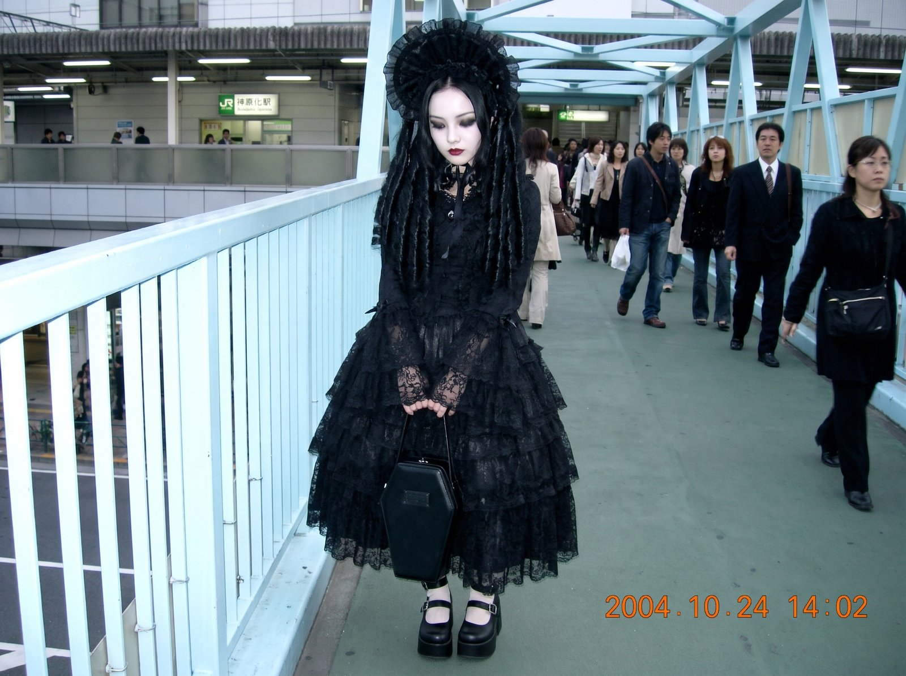
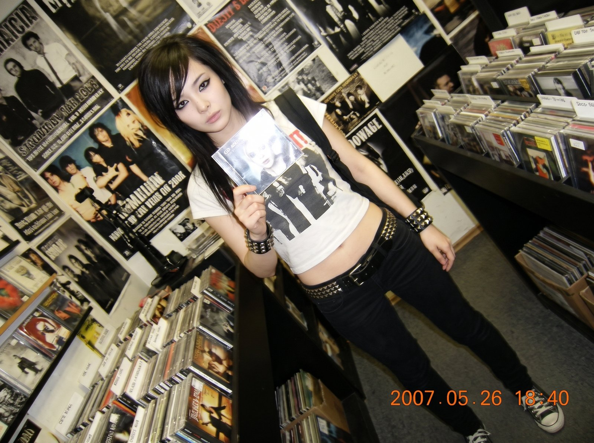
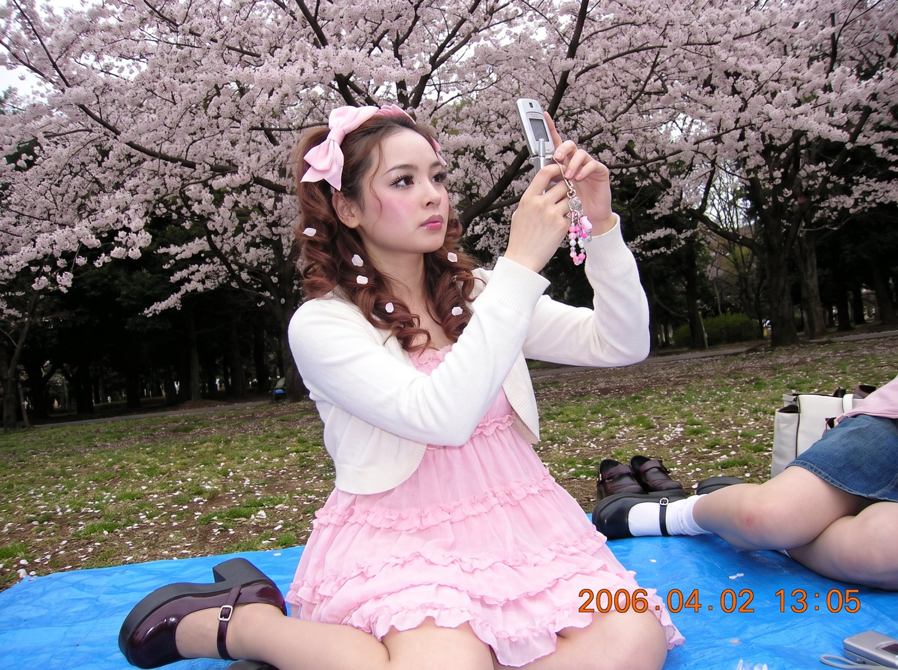

<div align="center">

# 東京ガチャ · TOKYO GACHA

**A capsule machine that sends you on a surprise trip to 2000s Japan.**

Upload your selfies, turn the crank, open the capsule, and get a digicam photo of yourself in an era-accurate Tokyo street look, with the flash, the grain and the orange date stamp.

[**▶ Try the app on Higgsfield**](https://higgsfield.ai/supercomputer/apps/d3994ba7-eee2-4e00-aacf-921a471761cb/view)

`Higgsfield Soul` · `Higgsfield MCP` · `AI image generation` · `Consumer app concept`

</div>

---

## How it works

```
 upload selfies  ──▶  turn the crank  ──▶  open the capsule  ──▶  save to the SD-card album
```

- **30 themes** across **4 rarities**: `N` · `R` · `SR` · `UR`
- **Daily capsule** and a **7-day streak** to bring you back every day
- **Digicam SD-card album**: 30 slots, with empty `NO IMAGE` tiles that make you want to complete the set
- **Duplicates become new variations** instead of wasted pulls

## What I noticed in existing apps

The apps that get people to try, share and come back have four things in common:

| | Quality | Why it matters |
|---|---|---|
| 🔁 | **Reusable** | Every run gives a different combination. A one-off transformation is fun once; a format with variety becomes a habit. |
| 👆 | **Easy entry** | Simple from the first second. Apps overloaded with features and settings lose users before they reach the fun part. The strongest apps do one thing and make it obvious. |
| 🗂 | **History** | People want their results to pile up, so they can compare them and stay in control of what they've made, not get one image that disappears. |
| 📤 | **Share** | The output looks like something people already post: a familiar social format, recognizable at a glance, that needs no explanation. |

## Why this idea

TOKYO GACHA sits where two of today's strongest consumer trends meet.

**1. Nostalgia and vintage.** Gen Z is romanticizing the 2000s: digicams are back, Y2K fashion is everywhere, and "shot on an old camera" photos outperform polished ones. People don't just want a nice photo of themselves. They want a memory from an era they barely lived through.

**2. The thrill of randomness.** Blind boxes, gashapon and mystery boxes have shown that not knowing what you'll get is half the fun. The moment before the reveal creates excitement, rare drops create bragging rights, and an unfinished collection brings people back.

TOKYO GACHA combines both: every capsule is a surprise trip to 2000s Japan. It also covers all four qualities:

- **Reusable:** with 30 themes × 4 rarities, every pull is a new combination, and the Daily capsule and 7-day streak give a reason to return.
- **Easy entry:** one clear loop (upload, crank, open), with no menus to learn and no prompts to write. Everyone already knows how a capsule machine works.
- **History:** every photo goes into an album styled as a digicam SD card, and the empty slots create the urge to complete the set.
- **Share:** a 2000s digicam photo with a date stamp is already a native format on TikTok and Instagram. *"I pulled Ultra Rare"* gives people something to show off, and capsule openings work naturally as unboxing videos.

## Built for Soul

Soul is built for realistic, fashion-aware imagery that looks **shot, not generated**, so the concept plays to its strengths.

2000s Japanese street style is one of the richest aesthetic worlds online: **gyaru, decora, Gothic Lolita, visual kei, J-pop idols**. Every theme is written as a magazine-level look with era-accurate hair and makeup, referencing magazines like ***egg*, *Popteen*, *FRUiTS* and *KERA***.

## Who it's for

- **2000s and Y2K lovers:** people who collect low-rise jeans and butterfly clips, shoot on vintage digicams, and fill their moodboards with early-internet visuals. To them, a flash photo with a date stamp is the most desirable look there is.
- **Fans of Japanese street fashion:** followers of gyaru, decora, Gothic Lolita and visual kei, readers of FRUiTS archives, and anyone who dreams of Harajuku and Shibuya. They know these styles in detail, so they can tell whether a look is accurate.
- **Fashion-conscious creators:** people who carefully curate their Instagram, Pinterest or TikTok feed and need distinctive content that looks styled and authentic, not "AI-generated".
- **Collectors and blind-box fans:** gashapon, Pop Mart and gacha-game lovers who get hooked on the reveal and the urge to complete a set.

## Gallery

Sample pulls generated with the app:

<p align="center">
  
  
  
</p>

<p align="center"><sub><b>Gothic Lolita</b> · station footbridge, 2004 &nbsp;|&nbsp; <b>J-rock</b> · CD shop, 2007 &nbsp;|&nbsp; <b>Hime gyaru</b> · hanami picnic, 2006</sub></p>

## Built with

- [Higgsfield Soul](https://higgsfield.ai): photorealistic, fashion-aware image generation
- Higgsfield MCP / Supercomputer Apps: building and publishing the app

---

<div align="center">

Made by [@mlkyrei](https://github.com/mlkyrei)

</div>
